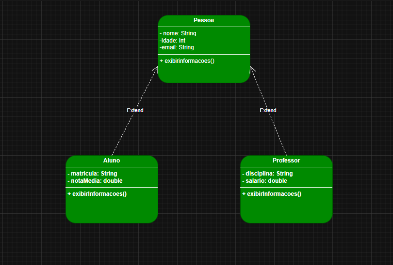

<div align="center">

# ☕ Java - Object-Oriented Programming

**A practical school management example built to learn the fundamentals of Java OOP.**


[](https://github.com/ErmeslyBlanc)

</div>

## About

This academic project demonstrates Java object-oriented programming concepts in an example involving students and teachers. It has no external dependencies.

**Concepts practiced:** encapsulation, constructors, validation, inheritance, method overriding and polymorphism.

## Project structure

```text
src/
  Pessoa.java        Base class and common validation
  Aluno.java         Student model with grade and registration
  Professor.java     Teacher model with subject and salary
  EscolaApp.java     Console demonstration
tests/
  EscolaTest.java    Automated checks
.github/workflows/
  java-ci.yml        Compile and test on GitHub Actions
```

## Class design

```text
Pessoa
  |-- Aluno
  |-- Professor
```

- **Pessoa** stores name, age and email.
- **Aluno** adds registration ID and average grade from 0 to 10.
- **Professor** adds subject and non-negative salary.
- **EscolaApp** creates sample instances and prints their information.



## Run locally

Requires a Java Development Kit (JDK 17 or newer).

```bash
javac -encoding UTF-8 -d out src/*.java
java -cp out EscolaApp
```

On Windows CMD, create the `out` directory first if needed. Java's `javac -d` writes compiled classes to the specified folder.

## Run automated tests

```bash
javac -encoding UTF-8 -d out src/*.java tests/*.java
java -cp out EscolaTest
```

The test runner uses standard Java only, verifying valid class construction, inheritance, getters and validation errors.

## Continuous integration

GitHub Actions compiles the application and executes the tests on push and pull request. The badge at the top reflects workflow status rather than a manually assigned result.

## Maintainer

**Ermesly Blanc** - [GitHub](https://github.com/ErmeslyBlanc) - [LinkedIn](https://www.linkedin.com/in/ermesly-blanc-640a1a170/)
